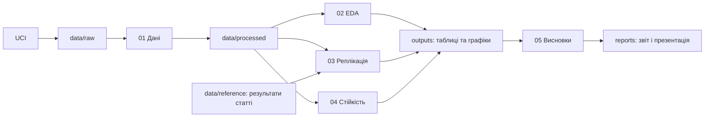

# Архітектура дослідження

## Принцип

Jupyter — основний інтерфейс дослідження: питання, обґрунтування, код,
графіки, інтерпретація. src/parentedu — невеликі функції, які можна перевірити
і повторно викликати. Не будуємо вебзастосунок, базу даних або складний ML-сервіс.

## Ноутбуки та результати

| Файл | Призначення | Майбутній вихід |
|---|---|---|
| 00_project_setup.ipynb | Питання, середовище, статус протоколу | Метадані середовища |
| 01_data.ipynb | Завантаження, SHA-256, паспорт, перевірка схем, фільтри | CSV вибірок, data_manifest.json |
| 02_eda.ipynb | Розподіли G3, Medu/Fedu, розміри груп, кореляції | Описові таблиці та графіки |
| 03_replication.ipynb | Моделі 1–4 та 7–10 таблиці 8 | Коефіцієнти, SE, CI, N, adjusted R², порівняння |
| 04_robustness.ipynb | Обґрунтовані зміни й плацебо | Таблиця стійкості, діагностика |
| 05_conclusions.ipynb | Вердикти, обмеження, узгодження доказів | Підсумкові таблиці для звіту |

Номери задають порядок роботи, а не спільне ядро. Пізні ноутбуки читають
data/processed і явні артефакти; моделі повторно будують через спільні функції.
Не передаємо між ноутбуками pickle-об'єкти моделей або приховані змінні.

## Модулі src/parentedu

- data.py: реалізовано P03 — pinned acquisition, кеш, маніфест, читання CSV та перевірки схеми.
- preparation.py: реалізовано P03 — єдиний фільтр, повний/реплікаційний шари, N та перевірений експорт.
- data_workflow.py: оркестрація notebook01, паспорт/словник, метадані, failed/prepared marker.
- models.py: реалізовано P05 — явні X/y, OLS/HC3/HC1/nonrobust, H1/H2 і діагностика.
- replication.py: еталони/Decimal-порівняння й окремі вердикти; replication_workflow.py: preflight/метадані.
- replication_reporting.py: 4 діагностичні фігури; EDA reporting.py незмінний.
- robustness.py: реалізовано P06 — окремі R1–R5, HC3, H3, фіксований noise та statuses.
- robustness_baseline.py: звірка M4/M10 з P05; robustness_workflow.py: preflight/експорти/метадані.
- robustness_reporting.py:3 агреговані фігури; P05-модулі та їхні hashes незмінні.
- Базовий тест рівності H2 залишається у models.py, не повторюється як нове підтвердження.
- conclusions.py: P07 — чистий синтез таблиць/реєстру; conclusions_workflow.py: hashes/експорти без fit.
- K3_conclusions.json: post-export перевірка версії аудитованих висновків, без циклу preflight.
- eda.py: реалізовано P04 — 8 описових таблиць, повні категорії та count-screen.
- eda_workflow.py: preflight за хешами P03, CSV/висновки, running/ready/failed metadata.
- reporting.py: реалізовано P04 — 5 графіків із агрегованих CSV у PNG/SVG.
- paths.py, config.py: уже створені мінімальні службові модулі.

environment.py: технічна перевірка .venv, імпортів, lock та локальні метадані запуску (P01).

Модулі додаємо разом із реалізацією; порожні функції, які імітують готовність,
не потрібні. Не додавати scikit-learn до потреби відтворити LASSO-процедури.

## Контракти даних та артефактів

- RAW: оригінальні student-mat.csv і student-por.csv, роздільник `;`.
- Одиниця спостереження — учень × предмет; предмети аналізуються окремо.
- Підготовлені дані зберігають вихідні коди, предмет і номер вихідного рядка.
- Вибірку точної реплікації не перезаписуємо вибіркою перевірки стійкості.
- Коефіцієнти: subject, model_id, variant, term, estimate, std_error,
  ci_low, ci_high, p_value, nobs, adjusted_r2, covariance_type.
- Порівняння: subject, model_id, term, original_value, replicated_value,
  absolute_difference, tolerance, verdict.
- Маніфест: URL, дата завантаження UTC, SHA-256, ліцензія, Python,
  версії пакетів, seed, git commit (якщо доступний), параметри запуску.
- Наші результати генерує код. Перенесені з публікації числа мають окреме
  джерело, номер таблиці/колонки і позначку ручної перевірки.

## Відтворюваність

Зафіксувати uv.lock до аналізу. Зберігати невеликі фінальні CSV і графіки в Git.
Сирі/підготовлені дані та виконані копії ноутбуків за замовчуванням ігноруються.
Вихідні ноутбуки зберігати без результатів; для перевірки виконувати копії в
outputs/executed. Коли весь аналіз реалізовано, додати послідовний runner із
зупинкою при помилці та інтеграційну перевірку повного запуску.

## Ролі агентів

Основний агент: архітектура, протокол, інтеграція, звіт.
data_researcher: джерела, паспорт даних, завантаження й підготовка.
statistical_analyst: моделі, формули, відтворення та перевірки стійкості.
research_reviewer: незалежна перевірка методів, чисел, запуску й формулювань.
Ролі визначено в .codex/agents/*.toml за офіційною схемою:
https://learn.chatgpt.com/docs/agent-configuration/subagents
Для всіх субагентів задано gpt-6.1-sol і reasoning effort low: загальні
значення у .codex/config.toml та явні поля в кожному файлі ролі.
Якщо клієнт не застосовує їх автоматично, координатор передає їх явно.
TOML-файли перевірено в P01; автоматичне виявлення ролей поточним клієнтом
не підтверджено. Поточний інтерфейс делегування не надає вибору custom agent
за ім'ям; reviewer отримує інструкції явно. Для перевірки виявлення потрібен
новий чат проєкту в клієнті з підтримкою вибору цих ролей.
